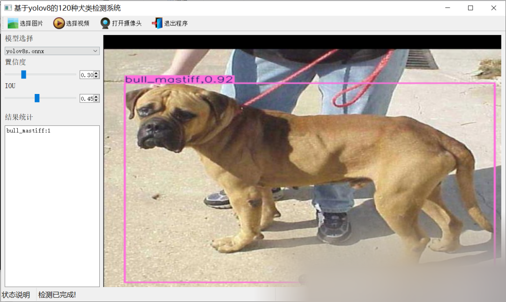
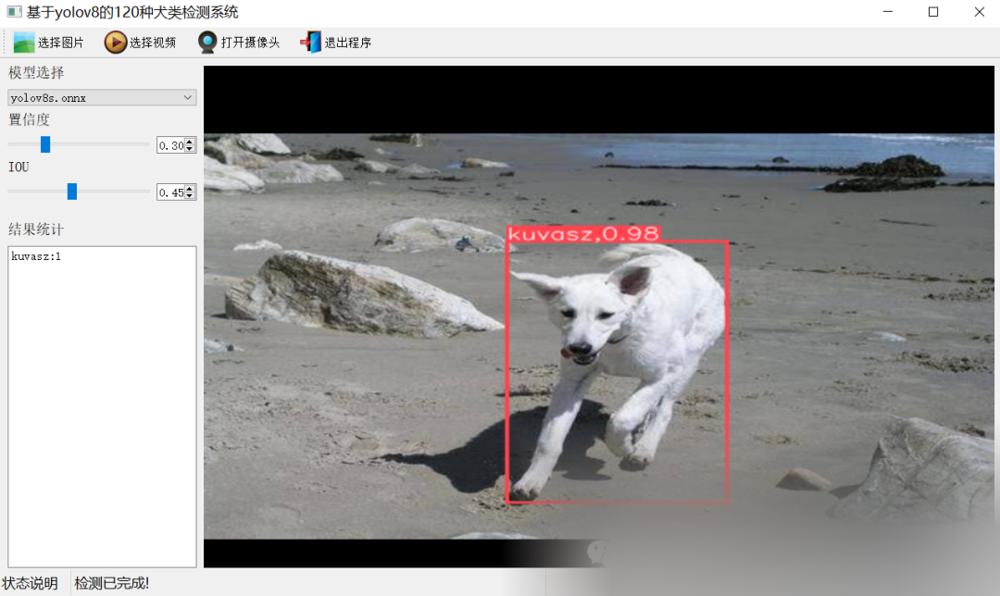

# 120 Dog Detection and Recognition System Based on Yolov8 Deep Learning in Python Source Code + ONNX Model + Evaluation Indicator Curve + Beautiful GUI Interface for Dog Detection

[Algorithm Introduction]

The 120 Dog Detection and Identification System based on YOLOv8 Deep Learning is a powerful tool. This system utilizes the YOLOv8 deep learning framework, trained with 21583 images, to achieve precise detection and identification of 120 dog breeds.

The system is developed based on Python and PyQt5, featuring a simple UI interface. It supports three methods for target detection: images, videos, and cameras, and can save the detection results. During the detection process, the system can display real-time information such as the position of the target, total number of targets, confidence level, and time consumption, providing users with intuitive and clear detection results.

This system has wide application value in multiple fields. In the field of public safety, police and security personnel can use it to quickly identify search and rescue dogs, police dogs, and potential dangerous dog breeds, thereby improving work efficiency and response speed. In the pet industry, it helps pet stores, veterinary clinics, and animal shelters to more accurately record and manage dog information, providing more personalized services. Additionally, it can be used for monitoring the number and distribution of stray dogs in urban management, addressing public health issues and safety risks, as well as precise management of sheepdogs in ranches and farms.

In summary, the 120-dog detection and recognition system based on YOLOv8 deep learning is an efficient, accurate, and user-friendly tool. Its emergence will greatly promote the development of dog detection and recognition technology, bringing convenience and value to multiple fields.

[Effect Display]





[Test Environment]

windows10
anaconda3+python3.8
torch==1.9.0+cu111
ultralytics==8.2.95

The model can detect the category.

-
-
-
-
-
-
-
-
-
-
-
-
-
-
-
-
-
-
-
-
-
-
-
-
-
-
-
-
-
-
-
-
-
-
-
-
-
-
-
-
-
-
-
-
-
-
-
-
-
-
-
-
-
-
-
-
-
-
-
-
-
-
-
-
-
-
-
-
-
-
-
-
-
-
-
-
-
-
-
-
-
-
-
-
-
-
-
-
-
-
-
-
-
-
-
-
-
-
-
-
-
-
-
-
-
-
-
-
-
-
-
-
-
-
-
-
-
-
-
-

```
affenpinscherafghan_houndafrican_hunting_dogairedaleamerican_staffordshire_terrierappenzelleraustralian_terrierbasenjibassetbeaglebedlington_terrierbernese_mountain_dogblack-and-tan_coonhoundblenheim_spanielbloodhoundbluetickborder_collieborder_terrierborzoiboston_bullbouvier_des_flandresboxerbrabancon_griffonbriardbrittany_spanielbull_mastiffcairncardiganchesapeake_bay_retrieverchihuahuachowclumbercocker_spanielcolliecurly-coated_retrieverdandie_dinmontdholedingodobermanenglish_foxhoundenglish_setterenglish_springerentlebuchereskimo_dogflat-coated_retrieverfrench_bulldoggerman_shepherdgerman_short-haired_pointergiant_schnauzergolden_retrievergordon_settergreat_danegreat_pyreneesgreater_swiss_mountain_doggroenendaelibizan_houndirish_setterirish_terrierirish_water_spanielirish_wolfhounditalian_greyhoundjapanese_spanielkeeshondkelpiekerry_blue_terrierkomondorkuvaszlabrador_retrieverlakeland_terrierleonberglhasamalamutemalinoismaltese_dogmexican_hairlessminiature_pinscherminiature_poodleminiature_schnauzernewfoundlandnorfolk_terriernorwegian_elkhoundnorwich_terrierold_english_sheepdogotterhoundpapillonpekinesepembrokepomeranianpugredbonerhodesian_ridgebackrottweilersaint_bernardsalukisamoyedschipperkescotch_terrierscottish_deerhoundsealyham_terriershetland_sheepdogshih-tzusiberian_huskysilky_terriersoft-coated_wheaten_terrierstaffordshire_bullterrierstandard_poodlestandard_schnauzersussex_spanieltibetan_mastifftibetan_terriertoy_poodletoy_terriervizslawalker_houndweimaranerwelsh_springer_spanielwest_highland_white_terrierwhippetwire-haired_fox_terrieryorkshire_terrier
```

[Training Information]

| Parameter | Value |
| ----------- | -------- |
| Training set images count | 18945 |
| Validation set images count | 1738 |
| Training map | 73.5% |
| Training precision (Precision) | 69.8% |
| Training recall (Recall) | 67.9% |

###### [Partial Implementation Source Code]

-
-
-
-
-
-
-
-
-
-
-
-
-
-
-
-
-
-
-
-
-
-
-
-
-
-
-
-
-
-
-
-
-
-
-
-
-
-
-
-
-
-
-
-
-
-
-
-
-
-
-
-
-
-
-
-
-
-
-
-
-
-
-
-
-
-
-
-
-
-
-
-
-
-
-
-
-
-
-
-
-
-
-
-
-
-
-
-
-
-
-
-
-
-
-
-
-
-
-
-
-
-
-
-
-
-
-
-

```
class Ui_MainWindow(QtWidgets.QMainWindow):    signal = QtCore.pyqtSignal(str, str)     def setupUi(self):        self.setObjectName("MainWindow")        self.resize(1280, 728)        self.centralwidget = QtWidgets.QWidget(self)        self.centralwidget.setObjectName("centralwidget")         self.weights_dir = './weights'         self.picture = QtWidgets.QLabel(self.centralwidget)        self.picture.setGeometry(QtCore.QRect(260, 10, 1010, 630))        self.picture.setStyleSheet("background:black")        self.picture.setObjectName("picture")        self.picture.setScaledContents(True)        self.label_2 = QtWidgets.QLabel(self.centralwidget)        self.label_2.setGeometry(QtCore.QRect(10, 10, 81, 21))        self.label_2.setObjectName("label_2")        self.cb_weights = QtWidgets.QComboBox(self.centralwidget)        self.cb_weights.setGeometry(QtCore.QRect(10, 40, 241, 21))        self.cb_weights.setObjectName("cb_weights")        self.cb_weights.currentIndexChanged.connect(self.cb_weights_changed)         self.label_3 = QtWidgets.QLabel(self.centralwidget)        self.label_3.setGeometry(QtCore.QRect(10, 70, 72, 21))        self.label_3.setObjectName("label_3")        self.hs_conf = QtWidgets.QSlider(self.centralwidget)        self.hs_conf.setGeometry(QtCore.QRect(10, 100, 181, 22))        self.hs_conf.setProperty("value", 25)        self.hs_conf.setOrientation(QtCore.Qt.Horizontal)        self.hs_conf.setObjectName("hs_conf")        self.hs_conf.valueChanged.connect(self.conf_change)        self.dsb_conf = QtWidgets.QDoubleSpinBox(self.centralwidget)        self.dsb_conf.setGeometry(QtCore.QRect(200, 100, 51, 22))        self.dsb_conf.setMaximum(1.0)        self.dsb_conf.setSingleStep(0.01)        self.dsb_conf.setProperty("value", 0.25)        self.dsb_conf.setObjectName("dsb_conf")        self.dsb_conf.valueChanged.connect(self.dsb_conf_change)        self.dsb_iou = QtWidgets.QDoubleSpinBox(self.centralwidget)        self.dsb_iou.setGeometry(QtCore.QRect(200, 160, 51, 22))        self.dsb_iou.setMaximum(1.0)        self.dsb_iou.setSingleStep(0.01)        self.dsb_iou.setProperty("value", 0.45)        self.dsb_iou.setObjectName("dsb_iou")        self.dsb_iou.valueChanged.connect(self.dsb_iou_change)        self.hs_iou = QtWidgets.QSlider(self.centralwidget)        self.hs_iou.setGeometry(QtCore.QRect(10, 160, 181, 22))        self.hs_iou.setProperty("value", 45)        self.hs_iou.setOrientation(QtCore.Qt.Horizontal)        self.hs_iou.setObjectName("hs_iou")        self.hs_iou.valueChanged.connect(self.iou_change)        self.label_4 = QtWidgets.QLabel(self.centralwidget)        self.label_4.setGeometry(QtCore.QRect(10, 130, 72, 21))        self.label_4.setObjectName("label_4")        self.label_5 = QtWidgets.QLabel(self.centralwidget)        self.label_5.setGeometry(QtCore.QRect(10, 210, 72, 21))        self.label_5.setObjectName("label_5")        self.le_res = QtWidgets.QTextEdit(self.centralwidget)        self.le_res.setGeometry(QtCore.QRect(10, 240, 241, 400))        self.le_res.setObjectName("le_res")        self.setCentralWidget(self.centralwidget)        self.menubar = QtWidgets.QMenuBar(self)        self.menubar.setGeometry(QtCore.QRect(0, 0, 1110, 30))        self.menubar.setObjectName("menubar")        self.setMenuBar(self.menubar)        self.statusbar = QtWidgets.QStatusBar(self)        self.statusbar.setObjectName("statusbar")        self.setStatusBar(self.statusbar)        self.toolBar = QtWidgets.QToolBar(self)        self.toolBar.setToolButtonStyle(QtCore.Qt.ToolButtonTextBesideIcon)        self.toolBar.setObjectName("toolBar")        self.addToolBar(QtCore.Qt.TopToolBarArea, self.toolBar)        self.actionopenpic = QtWidgets.QAction(self)        icon = QtGui.QIcon()        icon.addPixmap(QtGui.QPixmap(":/images/1.png"), QtGui.QIcon.Normal, QtGui.QIcon.Off)        self.actionopenpic.setIcon(icon)        self.actionopenpic.setObjectName("actionopenpic")        self.actionopenpic.triggered.connect(self.open_image)        self.action = QtWidgets.QAction(self)        icon1 = QtGui.QIcon()        icon1.addPixmap(QtGui.QPixmap(":/images/2.png"), QtGui.QIcon.Normal, QtGui.QIcon.Off)        self.action.setIcon(icon1)        self.action.setObjectName("action")        self.action.triggered.connect(self.open_video)        self.action_2 = QtWidgets.QAction(self)        icon2 = QtGui.QIcon()        icon2.addPixmap(QtGui.QPixmap(":/images/3.png"), QtGui.QIcon.Normal, QtGui.QIcon.Off)        self.action_2.setIcon(icon2)        self.action_2.setObjectName("action_2")        self.action_2.triggered.connect(self.open_camera)         self.actionexit = QtWidgets.QAction(self)        icon3 = QtGui.QIcon()        icon3.addPixmap(QtGui.QPixmap(":/images/4.png"), QtGui.QIcon.Normal, QtGui.QIcon.Off)        self.actionexit.setIcon(icon3)        self.actionexit.setObjectName("actionexit")        self.actionexit.triggered.connect(self.exit)         self.toolBar.addAction(self.actionopenpic)        self.toolBar.addAction(self.action)        self.toolBar.addAction(self.action_2)        self.toolBar.addAction(self.actionexit)         self.retranslateUi()        QtCore.QMetaObject.connectSlotsByName(self)        self.init_all()
```

[Usage Steps]

Usage Steps:
1. First, install the YOLOv8 environment according to the official framework https://github.com/ultralytics/ultralytics and PyQt5 installation tutorial.
2. After switching to your installed YOLOv8 environment, navigate to the source code directory and execute python main.py to start the interface for operation.

[Provided Files]

Python source code
YOLOv8s.onnx model (without PyTorch model)
Training map, P, R curves (in weights\results.png)
Test images (under test_img folder)


## Payment

Here is a pay link on Stripe ( https://buy.stripe.com/3cs8yP7sY87d0vu9AB ). Please contact me lonlonago@foxmail.com after funding $89, and I will send you a complete data files , thank you!


